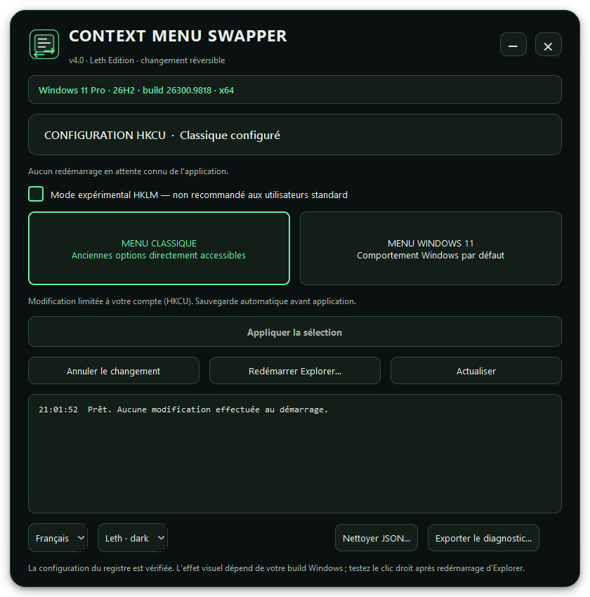

# Win11 Context Menu Swapper — v4.0

[Français](#français) · [English](#english) · [Release notes FR/EN](docs/RELEASE_NOTES-v4.0.md)

## Français

Retrouvez le menu contextuel classique ou rétablissez le comportement Windows par défaut depuis une interface Qt 6 arrondie, disponible en français comme en anglais.

**[Télécharger la version portable V4.0](https://github.com/Lethudu70/Win11-Context-Menu-Swapper/releases/tag/V4.0)** · [Documentation et compilation](V4/README.md) · [Versions précédentes](https://github.com/Lethudu70/Win11-Context-Menu-Swapper/releases)



### Les nouveautés

- **Fenêtre Qt 6 sans bordure Windows**, coins arrondis, boutons réduire/fermer personnalisés et icône intégrée.
- **Windows détecté automatiquement** : édition, version, build complète et architecture native.
- **Changements vérifiés** : état du registre affiché, sauvegarde avant modification et contrôle après écriture.
- **Annulation persistante**, avec restauration de l'état précédent et détection des changements effectués par un autre outil.
- **Redémarrage d'Explorer à la demande**, quand vous choisissez de l'effectuer.
- **Interface FR/EN**, thèmes sombre/système, cases à cocher contrastées et diagnostic exportable.
- **Nettoyage JSON ciblé**, avec conservation des fichiers inconnus et archivage de l'historique actif si vous le réinitialisez.
- **Mode HKLM expérimental séparé**, avec UAC et confirmation explicite.

### Installer et utiliser

1. Téléchargez `ContextMenuSwapper-v4.0-win64-portable.zip` depuis la release V4.0.
2. Extrayez **tout le ZIP** dans un dossier de votre choix.
3. Lancez `ContextMenuSwapper.exe`. Conservez les DLL et les sous-dossiers, notamment `platforms`.
4. Choisissez le menu classique ou le comportement Windows par défaut, puis cliquez sur **Appliquer la sélection**.
5. Redémarrez Explorer quand vous le souhaitez, puis testez le clic droit.

Le portable fournit les bibliothèques nécessaires : Python, Qt et MSYS2 ne sont pas requis sur le PC destinataire. Le mode standard cible votre compte (**HKCU**) et ne demande pas les droits administrateur. Les préférences et l'historique restent dans le profil Windows de l'utilisateur.

### HKLM : réservé aux essais avancés

**EXPÉRIMENTAL — NON RECOMMANDÉ AUX UTILISATEURS STANDARD.** L'option est décochée à chaque lancement. HKLM peut affecter tous les comptes du PC ; un réglage HKCU peut rester prioritaire.

Appliquer ou restaurer en HKLM lance un processus administrateur via l'UAC, puis demande une confirmation. Si Windows protège la valeur, une seconde confirmation peut autoriser une tentative avec le privilège de restauration Windows. Le programme conserve le propriétaire et les permissions de la clé. La sauvegarde machine est distincte de l'historique HKCU.

L'effet de l'override dépend de la build de Windows et des politiques du PC. Une écriture vérifiée dans le registre ne garantit pas l'effet visuel du menu. Testez HKLM dans Windows Sandbox ou dans une VM avant tout usage sur un système principal. Voir la [documentation complète](V4/README.md) et l'[aperçu du mode expérimental](docs/images/v4.0-hklm.png).

### Compiler soi-même

Le code de la v4.0 se trouve dans `V4/`. Il utilise **C++17, Qt 6 Widgets, MSYS2 UCRT64, CMake et Ninja**.

```powershell
cd V4
powershell -NoProfile -ExecutionPolicy Bypass -File .\scripts\build-ucrt64.ps1
```

Le script compile, exécute les tests, rassemble Qt et les DLL UCRT64 nécessaires, puis produit un ZIP portable. Les [instructions détaillées](V4/README.md) expliquent les paquets à installer et les options de compilation. GitHub Actions effectue également la compilation et le packaging sous Windows.

### Validation et anciennes versions

Les tests couvrent les sauvegardes, annulations, refus d'accès, permissions conservées, conflits externes et nettoyages JSON. Les essais HKLM automatisés redirigent la ruche vers une clé temporaire ; ils ne modifient pas le menu de la machine de compilation. Les vérifications visuelles sur chaque build Windows restent nécessaires. Les exécutables ne sont pas signés.

La V3 C++ et la version Python historique sont conservées dans le dépôt et les anciennes releases. Pour la nouvelle version C++/Qt 6, utilisez `V4/`.

## English

Context Menu Swapper v4.0 lets you restore the classic context menu or return to the default Windows behavior from a rounded Qt 6 interface, available in French and English.

**[Download the V4.0 portable release](https://github.com/Lethudu70/Win11-Context-Menu-Swapper/releases/tag/V4.0)** · [Technical documentation and build instructions (French)](V4/README.md) · [Previous releases](https://github.com/Lethudu70/Win11-Context-Menu-Swapper/releases)

### What's new

- **Frameless Qt 6 window** with rounded corners, custom minimize/close buttons and an embedded application icon.
- **Automatic Windows detection**: edition, version, full build number and native architecture.
- **Verified changes**: the current registry configuration is displayed, a backup is saved before modification, and writes are checked afterward.
- **Persistent undo**, restoring the previous state and detecting changes made by another tool.
- **Explorer restart on demand**, when you choose to perform it.
- **French/English interface**, dark/system themes, high-contrast checkboxes and exportable diagnostics.
- **Targeted JSON cleanup**, preserving unknown files and archiving active undo history if you choose to reset it.
- **Separate experimental HKLM mode**, with UAC authorization and explicit confirmation.

### Installation and use

1. Download `ContextMenuSwapper-v4.0-win64-portable.zip` from the V4.0 release.
2. Extract **the entire ZIP** into a folder of your choice.
3. Run `ContextMenuSwapper.exe`. Keep its DLLs and subfolders, especially `platforms`.
4. Select the classic menu or the default Windows behavior, then click **Apply selection**.
5. Restart Explorer when convenient, then test the context menu.

The portable package includes its required libraries: Python, Qt and MSYS2 do not need to be installed on the destination PC. The default mode targets your account (**HKCU**) and does not require administrator rights. Preferences and undo history stay in the Windows user profile.

### HKLM: advanced experiments only

**EXPERIMENTAL — NOT RECOMMENDED FOR STANDARD USERS.** The option starts unchecked every time the application opens. HKLM can affect all accounts on the PC; an HKCU setting may take precedence.

Applying or restoring an HKLM change starts an administrator process through UAC, then asks for confirmation. If Windows protects the value, a second confirmation can authorize an attempt using the Windows restore privilege. The program preserves the key's ownership and permissions. The machine backup is separate from HKCU undo history.

The override's effect depends on the Windows build and system policies. A verified registry write does not guarantee the visual menu behavior. Test HKLM in Windows Sandbox or a virtual machine before using it on a primary system. See the [technical documentation (French)](V4/README.md) and the [experimental-mode screenshot](docs/images/v4.0-hklm.png).

### Build from source

The v4.0 source is in `V4/`. It uses **C++17, Qt 6 Widgets, MSYS2 UCRT64, CMake and Ninja**.

```powershell
cd V4
powershell -NoProfile -ExecutionPolicy Bypass -File .\scripts\build-ucrt64.ps1
```

The script builds the application, runs its tests, collects Qt and the required UCRT64 DLLs, and creates a portable ZIP. The [detailed build instructions (French)](V4/README.md) list the packages to install and the build options. GitHub Actions also builds and packages the application on Windows.

### Validation and previous versions

Tests cover backups, undo, access denial, unchanged permissions, external conflicts and JSON cleanup. Automated HKLM tests redirect the hive to a temporary key; they do not change the build machine's context menu. Visual checks are still needed for each Windows build. The executables are unsigned.

The C++ V3 and historical Python version remain available in the repository and older releases. Use `V4/` for the new C++/Qt 6 version.
