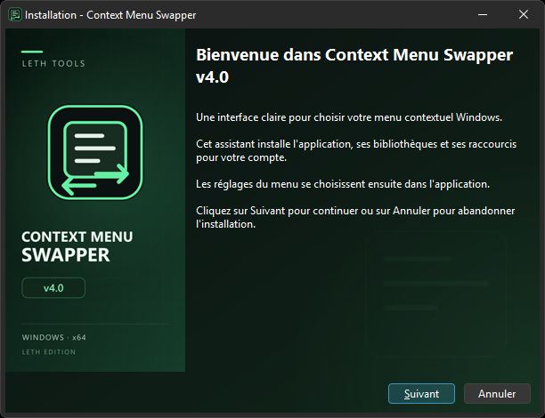
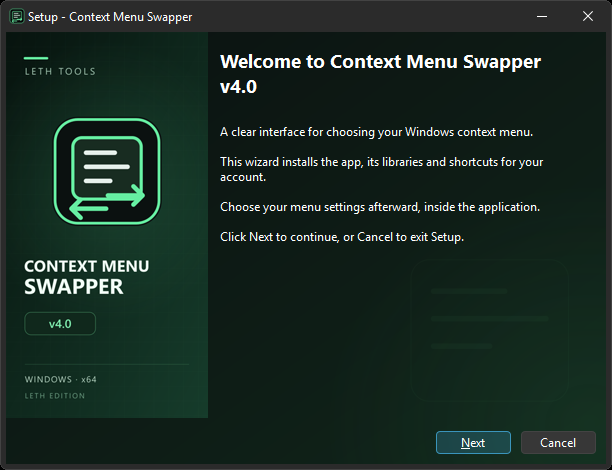

# Inno Setup — Context Menu Swapper v4.0

[Français](#français) · [English](#english)

## Français

Installateur personnel avec thème sombre noir/vert, illustration latérale, icônes intégrées et raccourcis. **Le français est sélectionné par défaut**, indépendamment de la langue de Windows. L'anglais peut être choisi au démarrage. Le choix est proposé à chaque nouvelle installation.

Le setup installe les fichiers de l'application, ses DLL et ses plugins Qt sous `%LOCALAPPDATA%\Programs\LethTools\ContextMenuSwapper`, avec une entrée dans Applications installées et un raccourci du menu Démarrer. Le raccourci Bureau est optionnel et décoché par défaut.

Il ne demande pas les droits administrateur et ne modifie pas le menu Windows. L'UAC reste réservé aux opérations HKLM dans l'application. La désinstallation retire les fichiers installés et les raccourcis ; elle conserve les préférences, l'historique d'annulation et la configuration Windows.



### Compiler

Utiliser **Inno Setup 6.7 ou ultérieur** avec son pack de langues officiel. Les images PNG sont fournies ; les sources SVG et `make_artwork.py` permettent de les régénérer avec librsvg et Pillow.

Extraire le ZIP portable de la release V4.0, puis depuis la racine du dépôt :

```powershell
.\V4\scripts\build-installer.ps1 -PortableDirectory 'C:\chemin\vers\le\portable' -OutputDirectory 'C:\chemin\vers\la\sortie'
```

Le script produit `ContextMenuSwapper-v4.0-Setup.exe` et son fichier `.sha256`. Les DLL et l'exécutable installés proviennent du portable, sans recompilation du programme.

`V4/scripts/test-installer.ps1` vérifie l'installation, les empreintes des fichiers, les icônes/raccourcis, le test du programme installé et la désinstallation. Il refuse de s'exécuter si une installation existante ou le groupe de raccourcis cible risquent d'être modifiés. Utiliser un compte de test ou une VM pour ces essais.

## English

A per-user installer with a dark green/black theme, custom wizard artwork, embedded icons and shortcuts. **French is selected by default**, regardless of the Windows display language. English can be selected at startup. The language choice is shown for each new installation.

Setup installs the app, DLLs and Qt plugins under `%LOCALAPPDATA%\Programs\LethTools\ContextMenuSwapper`, adds an Installed Apps entry and creates a Start menu shortcut. The desktop shortcut is optional and unchecked by default.

Installation does not request administrator rights or change the Windows context menu. UAC remains limited to HKLM operations inside the app. Uninstall removes installed files and shortcuts while preserving preferences, undo history and Windows configuration.



### Build

Use **Inno Setup 6.7 or later** with its official language files. Extract the published V4.0 portable ZIP and run `V4/scripts/build-installer.ps1` with `-PortableDirectory` and `-OutputDirectory`. Pre-rendered PNG assets are included; SVG sources and `make_artwork.py` allow regeneration with librsvg and Pillow.

The script creates `ContextMenuSwapper-v4.0-Setup.exe` and its `.sha256` file. The installed executable and libraries come from the portable release; the application is not rebuilt.

The installer test checks file hashes, uninstall registration, shortcuts/icons, the installed application's self-test and uninstallation. It refuses to overwrite an existing installation or shortcut group. Use an isolated test account or virtual machine.
